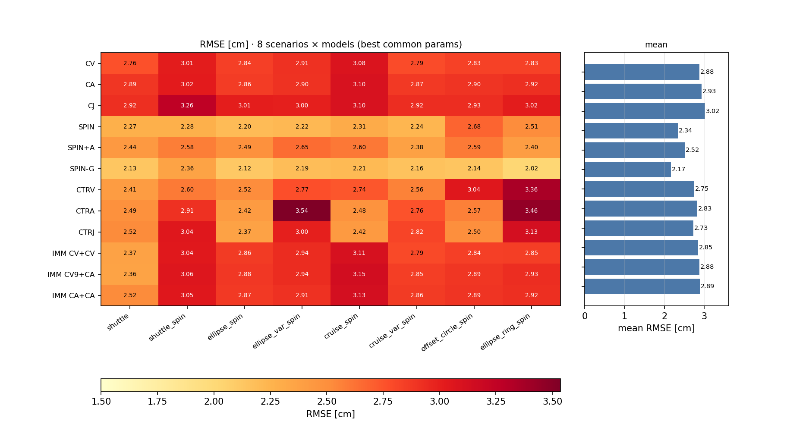
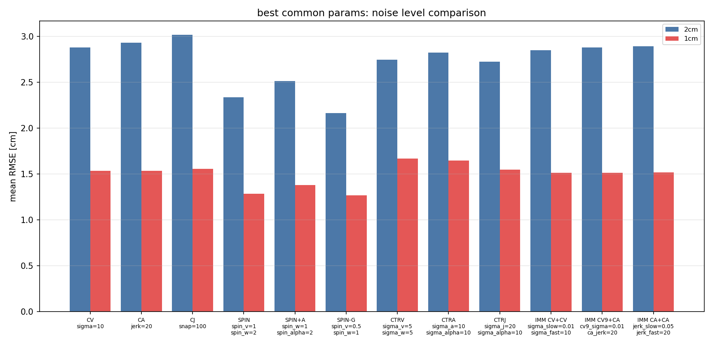
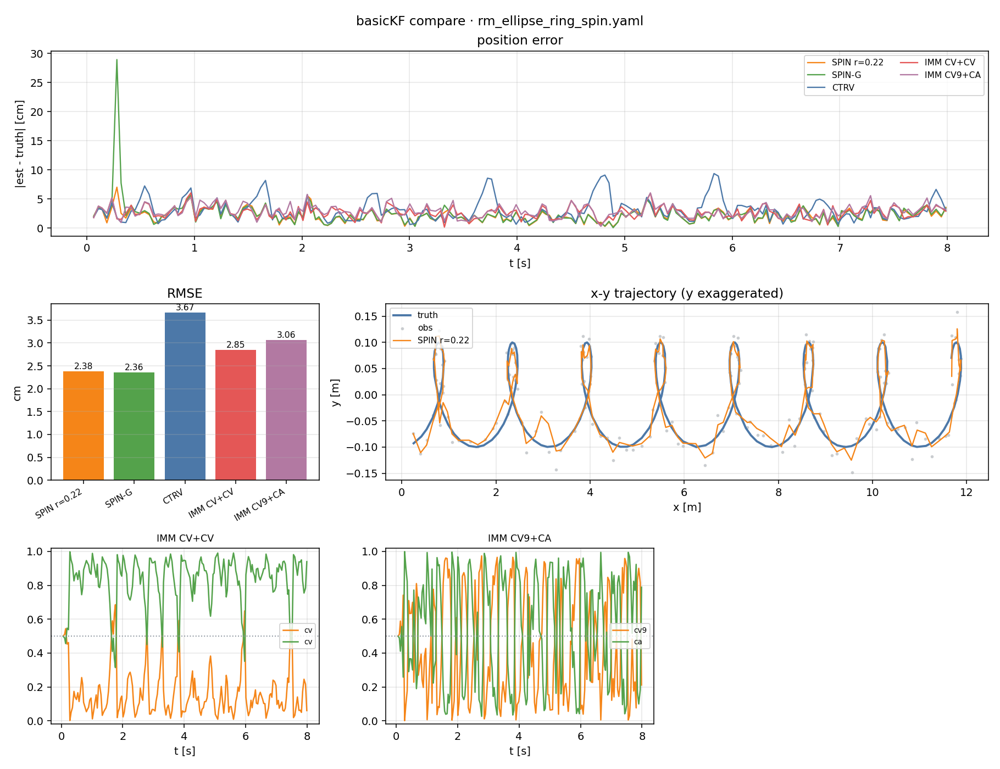
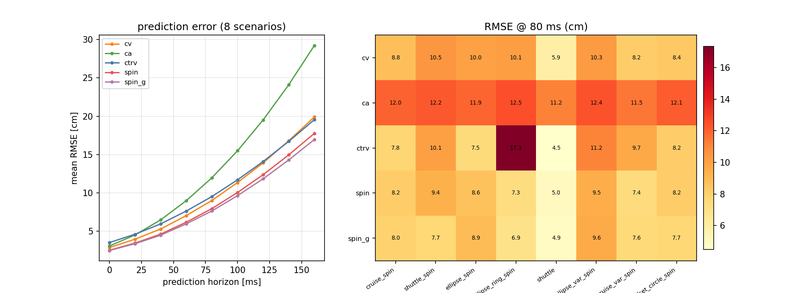

# basicKF 滤波方案对比总结（8 工况）

> 场景：RM 车体 3D 运动 + 装甲板观测；指标：**装甲板位置**（击打目标）。
> 观测噪声用真实值，过程噪声固定物理先验，不逐场景调参。

## 1. 模型

| 模型 | 状态 | 说明 |
|---|---|---|
| CV / CA / CJ | `[p,v]` / +a / +j | 线性模型 |
| CTRV / CTRA / CTRJ | `[x,y,ψ,v,ω]` +a / +j / +α | 协调转弯族（EKF） |
| SPIN | `[x,y,z,vx,vy,θ,ω]` | 底盘平移 + 装甲环自转，r=0.22 |
| SPIN+A | `[x,y,z,vx,vy,θ,ω,α]` | SPIN + **角加速度 α**（消融项：检验 α 是否有用） |
| SPIN-G | +`ox,oy,a,b` | 偏心圆 / 椭圆环 |
| IMM | — | CV+CV、CV9+CA、CA+CA |

## 2. 工况（8 个）

| 工况 | 说明 |
|---|---|
| shuttle | 折返跑，不转 |
| shuttle_spin | 折返 + 小陀螺 |
| ellipse_spin | 椭圆 + 小陀螺 |
| ellipse_var_spin | 椭圆 + 小陀螺 + 变速 |
| cruise_spin | 直线 + 小陀螺 |
| cruise_var_spin | 直线 + 小陀螺 + 变速 |
| offset_circle_spin | 偏心圆环（0.12, 0.05） |
| ellipse_ring_spin | 椭圆环（0.42 × 0.10） |

## 3. 精度：8 工况统一参数（2 cm）



| 模型 | mean | worst |
|---|---|---|
| CV | 2.88 | 3.08 |
| CA | 2.93 | 3.10 |
| CJ | 3.02 | 3.26 |
| CTRV | 2.75 | 3.36 |
| CTRA | 2.83 | 3.54 |
| CTRJ | 2.73 | 3.13 |
| **SPIN** | 2.34 | 2.68 |
| SPIN+A | 2.52 | 2.65 |
| **SPIN-G** | **2.17** | **2.36** |
| IMM CV+CV | 2.85 | 3.11 |
| IMM CV9+CA | 2.88 | 3.15 |
| IMM CA+CA | 2.89 | 3.13 |

SPIN+A 是 SPIN 加一个角加速度 α 状态（`dω/dt`）。它只用于消融验证：小陀螺转速恒定，
α 没有真实信号，只会往 Q 里灌噪声，所以 2.52 cm 反而比 SPIN 的 2.34 差——**α 不需要建模**。

结论：**带几何的自由度（SPIN-G）最好**；固定 r 的 SPIN 在偏心/椭圆工况退化到 2.5–2.7；
CTRV 在椭圆环工况明显变差（3.36）；高阶项 `α/j` 无收益。

## 4. 1 cm 噪声（8 工况）



| 模型 | 2 cm | 1 cm |
|---|---|---|
| CV | 2.88 | 1.53 |
| CA | 2.93 | 1.54 |
| CJ | 3.02 | 1.56 |
| SPIN | 2.34 | 1.29 |
| SPIN-G | 2.17 | **1.27** |
| CTRV | 2.75 | 1.67 |
| IMM CV+CV | 2.85 | 1.51 |

误差近似线性减半，参数基本不变。

## 5. 偏心 / 椭圆环（8 s）



| 模型 | 圆环 | 偏心圆 | 椭圆环 |
|---|---|---|---|
| SPIN r=0.22 | 2.64 | 2.66 | 2.38 |
| SPIN-G | 2.63 | 2.56 | 2.36 |
| CTRV | 2.84 | 3.59 | 3.67 |
| IMM CV+CV | 3.11 | 2.84 | 2.85 |
| IMM CV9+CA | 3.33 | 3.04 | 3.06 |

固定 r 的 SPIN 对板位置仍稳（底盘隐变量吸收几何误差），但底盘估计偏 20–34 cm。

**高低板高度差（armor_dh）**：新增 `rm_cruise_spin_dh0.yaml` / `rm_cruise_spin_dh.yaml`（dh=0.06）。
锁定单板时 SPIN/SPIN-G 结果完全一致（2.64 / 2.63 cm）——高度差只是让该板的 z 平移，被 z 状态吸收。
高度差只在**换板**时才有意义（auto_aim 的 EKF 估 Δh 正是为了关联/预测高低板）；当前对比锁定单板，所以测不出差异。
IMM 不依赖半径假设，几何工况下 2.8–2.9 cm，是通用兜底但不如 SPIN/SPIN-G。

## 6. 提前量预测（8 工况）



| 模型 | 0 ms | 40 ms | 80 ms | 120 ms | 160 ms |
|---|---|---|---|---|---|
| CV | 2.88 | 5.34 | 9.17 | 14.27 | 20.50 |
| CA | 3.07 | 6.45 | 11.95 | 19.52 | 29.31 |
| CTRV | 3.54 | 6.01 | 9.64 | 14.28 | 19.83 |
| SPIN | 2.53 | 4.68 | 8.13 | 12.74 | 18.37 |
| **SPIN-G** | **2.49** | **4.53** | **7.81** | **12.19** | **17.54** |

80 ms 时 SPIN 8.1 cm、CV 9.2、CTRV 9.6、CA 12.0；板 13×12 cm，80 ms 内 SPIN 勉强安全，
100 ms 以上开始赌。**先压延迟。**

## 7. R 估错鲁棒性（8 工况）

| 模型 | 0.1× | 0.25× | 0.5× | 1× | 2× | 4× | 10× |
|---|---|---|---|---|---|---|---|
| CV | 3.13 | 3.01 | 2.92 | 2.88 | 2.96 | 3.27 | 4.33 |
| CA | 3.27 | 3.21 | 3.15 | 3.08 | 3.02 | 2.96 | 2.92 |
| CTRV | 2.87 | 2.88 | 3.12 | 3.77 | 4.35 | 5.02 | 6.63 |
| SPIN | 2.97 | 2.80 | 2.59 | 2.53 | **2.35** | 2.49 | 2.83 |
| **SPIN-G** | 2.92 | 2.77 | 2.62 | 2.49 | 2.40 | **2.36** | 2.75 |

SPIN 最稳（0.25×–10× 内 2.35–2.97）；CTRV 对 R 最敏感；R 没把握时宁可估小。

## 8. 选型

1. 能锁板、几何已知 → **SPIN-G / SPIN**；
2. 未知模式/换板 → **IMM CV+CV** 兜底；
3. 要车体中心 → 不要用固定 r 的 SPIN；
4. 击打先压延迟，80 ms 是安全边界；
5. `α/j` 高阶项在本噪声下无收益。

## 9. 复现

```bash
cmake -S . -B build && cmake --build build -j4
python3 tools/tune.py                     # 8 工况精度
python3 tools/tune.py configs/kf/tune_1cm.yaml
python3 tools/plot_tune_compare.py build/kf/tune_result.json build/kf/tune_result_1cm.json --labels=2cm,1cm
./build/kf_future && python3 tools/plot_future.py
./build/kf_robust
ctest
```
